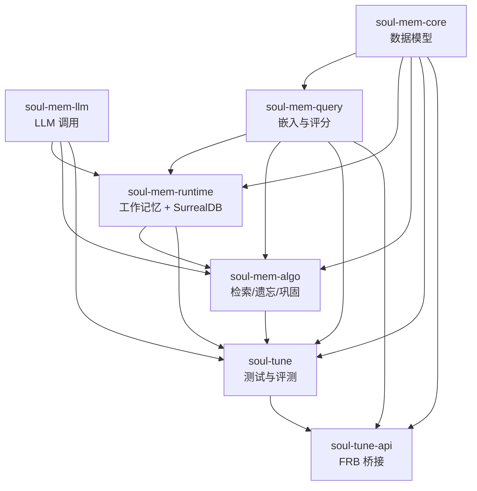
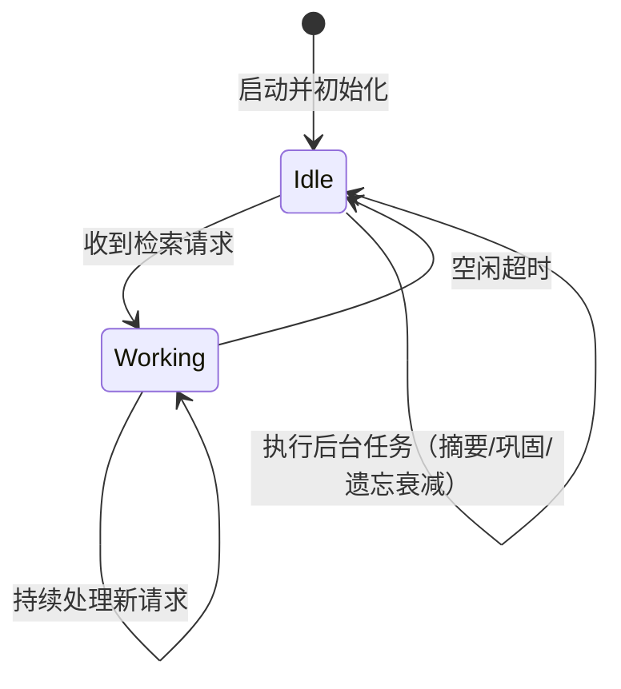
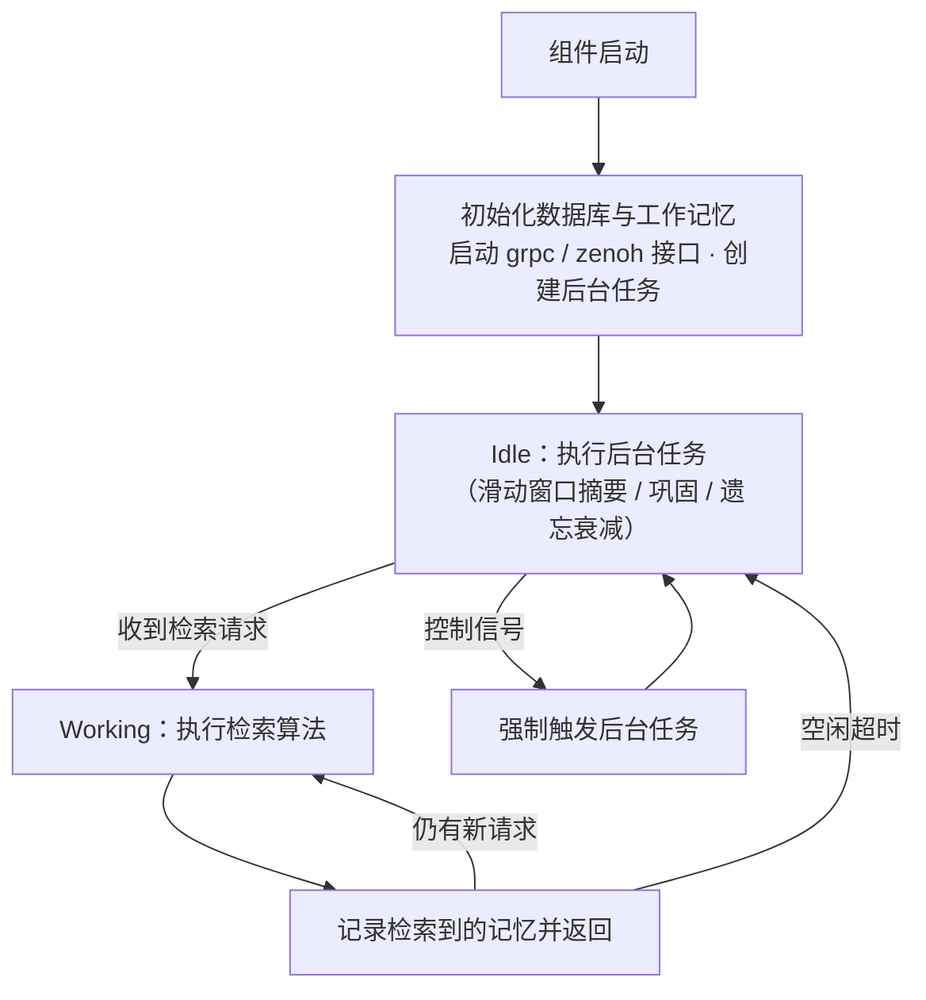

# 总体架构

在本章中，我们将介绍Soul计划组件的组织方式，以及SoulMem的模块结构和运行流程。

## Soul计划组件
本团队的目标是开发一个功能完整的赛博生命，并以组件化的方式进行实现。组件之间被建模为一个分布式系统，这允许我们的赛博生命在分布到多个机器去部署，以充分的利用家用设备的算力。我们基于zenoh来实现分布式系统，使用protobuf定义在组件之间传输的数据。

组件会区分为核心组件和边缘组件，其中，SoulMem属于核心组件之一。

组件将通过统一的GUI启动器进行启动，它将管理组件的生命周期，解析组件之间的依赖关系，并实时监控组件的状态，并尝试从错误状态中恢复。我们在此处沿用BEAM虚拟机的actor思想。

## SoulMem

### 模块结构

SoulMem采用workspace的组织方式：

- `soul-mem-core` —— 核心：定义记忆节点 `MemoryNote` 与记忆链接 `MemoryLink` 的纯数据结构及对外渲染契约。
- `soul-mem-query` —— 嵌入与评分：把记忆与查询向量化，并计算相似度分数。
- `soul-mem-llm` —— 统一 LLM 调用： LLM 调用入口，同时负责重试与错误分类。
- `soul-mem-runtime` —— 运行时：工作记忆与记忆簇，并通过 SurrealDB 仓储持久化。
- `soul-mem-algo` —— 记忆算法：实现检索、遗忘与巩固算法。
- `soul-tune` —— 测试与评测框架（headless CLI + lib），非运行时组件。
- `soul-tune-api` —— FRB 桥接：以 JSON-over-FRB 向 Flutter GUI 暴露 soul-tune 的测试能力。

**各 crate 的顶层模块**：

- `soul-mem-core`：`memory_note`（记忆节点）、`memory_links`（记忆链接）、`render`（对外渲染契约）。
- `soul-mem-query`：`embedding`（向量化与融合）、`query`（查询类型与相似度计算）。
- `soul-mem-llm`：`backend`（后端契约）、`engine`（调用编排）、`oai_comp`（OpenAI 兼容后端）、`observer`/`error`/`json`（观测、错误与 JSON 解析）。
- `soul-mem-runtime`：`working_memory`（工作记忆与滑动窗口）、`cluster`（记忆图 `MemoryCluster`）、`storage`（`MemoryRepository` trait 与 SurrealDB 实现）。
- `soul-mem-algo`：`algo`（检索/遗忘/巩固）、`common`（`ppr` 与 `ord_float`）。
- `soul-tune`：`base`、`engine`。
- `soul-tune-api`：`api`、`frb_generated`。

**crates 依赖关系**：

### 运行流程

SoulMem组件被启动后，取决于你对其的配置，它将启动grpc接口或zenoh接口（或者二者），初始化数据库与工作记忆，创建后台任务，并开始等待请求。

工作记忆具有Working与Idle两种状态，它将被初始化为Idle。

通常来说，SoulMem将从其检索接口接受到一系列的记忆检索请求，此时，工作记忆会转入Working状态，并执行检索算法，记录检索到的记忆并返回。若一段时间内没有额外的请求，工作记忆将转会Idle。

在Idle状态下，后台任务被允许执行，例如滑动窗口的摘要，巩固，以及遗忘衰减。

你也可以向SoulMem直接发送控制信号，这将会强制性的触发一些后台任务。

